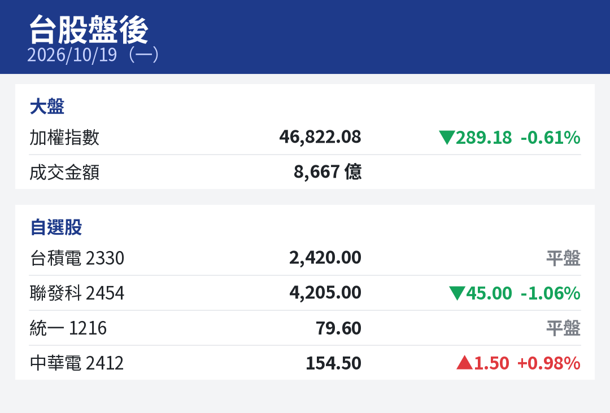
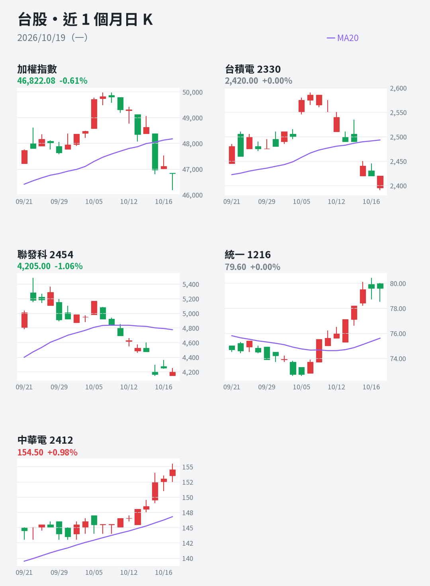
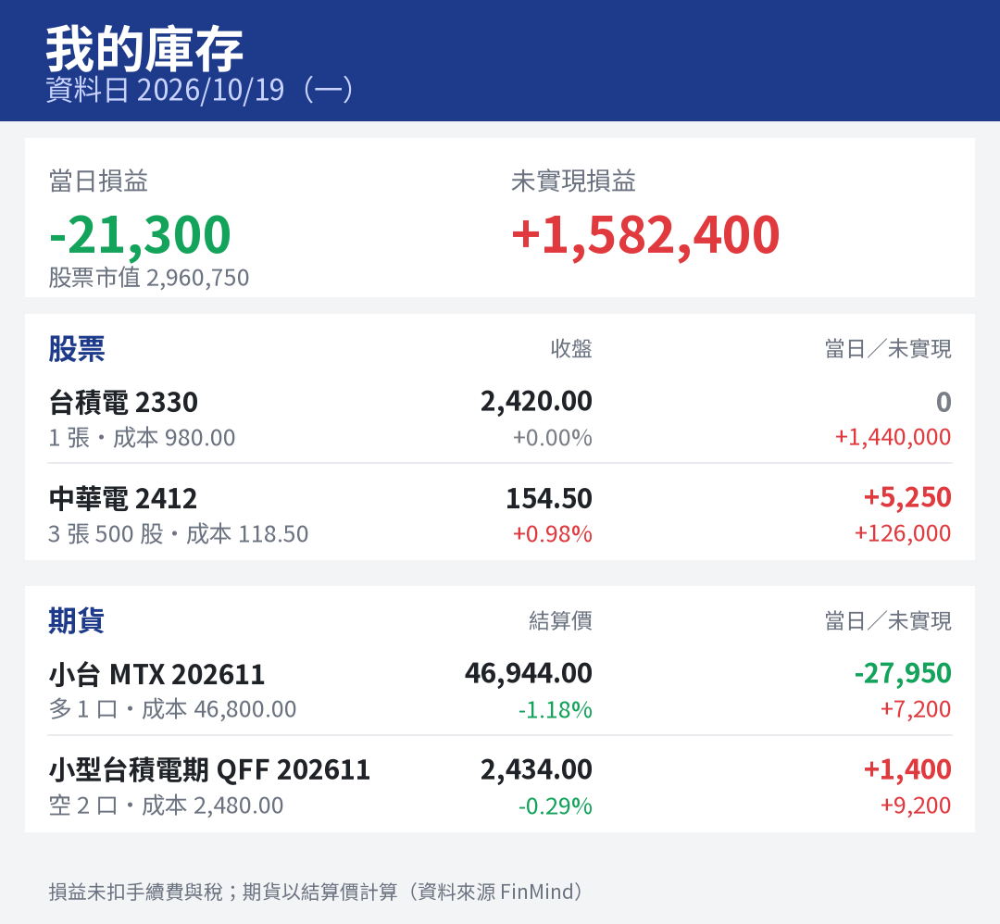
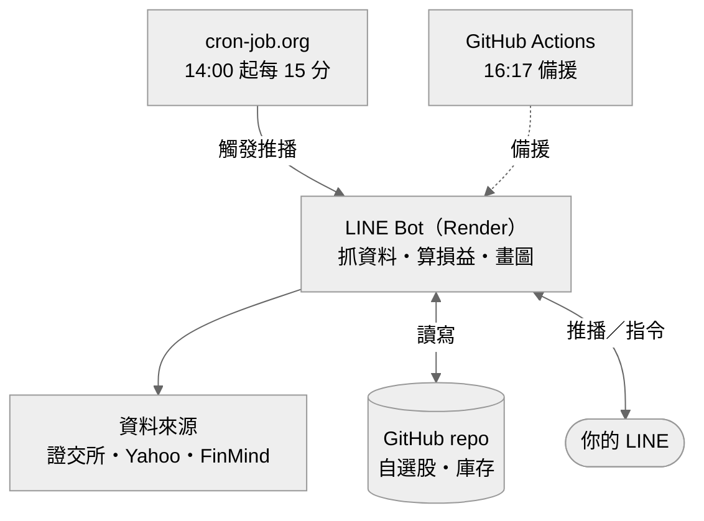
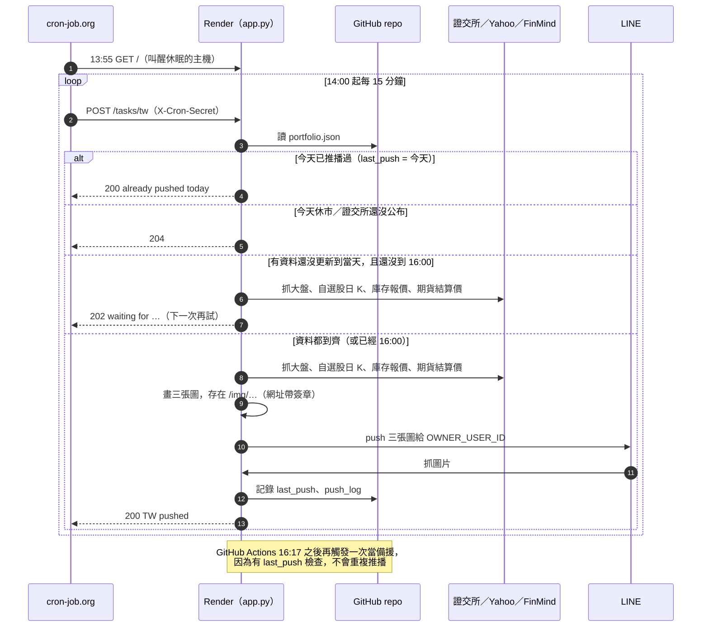
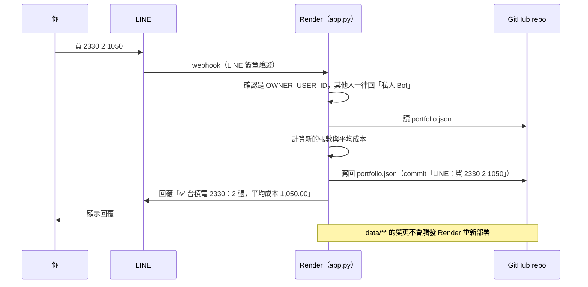

# LINE 台股盤後推播 Bot

每個交易日收盤後，自動在 LINE 推播三張圖給你：

| 圖 | 內容 |
|---|---|
| 1. 台股盤後 | 加權指數、成交金額、自選股收盤價與漲跌 |
| 2. 近 1 個月日 K | 加權指數＋每一檔自選股的日 K 線，含 MA20（紅漲綠跌） |
| 3. 我的庫存 | 每個部位的數量、成本、收盤／結算價、當日損益、未實現損益，以及合計 |

這個 Bot **只服務你一個人**：推播只發給你的 LINE 帳號，其他人加好友或傳訊息只會收到「私人 Bot」的回覆，也查不到你的庫存。

### 畫面預覽

| 1. 台股盤後 | 2. 近 1 個月日 K | 3. 我的庫存 |
|:---:|:---:|:---:|
|  |  |  |
| 大盤與自選股收盤 | 加權指數＋自選股，MA20 | 股票＋期貨的當日／未實現損益 |

<sub>範例圖為 2026/10/19 的真實行情；庫存是示範用的假資料。點圖可放大。</sub>

### 運作方式



---

## 目錄
1. [每天什麼時候推播](#1-每天什麼時候推播)
2. [LINE 指令總表](#2-line-指令總表)
3. [自選股怎麼設定](#3-自選股怎麼設定)
4. [庫存怎麼輸入](#4-庫存怎麼輸入)
5. [損益怎麼計算](#5-損益怎麼計算)
6. [直接在 GitHub 修改 portfolio.json](#6-直接在-github-修改-portfoliojson)
7. [常見問題](#7-常見問題)
8. [系統架構與設定（維護用）](#8-系統架構與設定維護用)

---

## 1. 每天什麼時候推播

- **週一到週五，資料一到齊就推**，通常在 **14:30～15:30** 之間（台北時間）。
  - [cron-job.org](https://console.cron-job.org/jobs) 從 14:00 起每 15 分鐘觸發一次（13:55 先叫醒休眠中的 Render）。
  - 每次觸發，Bot 會檢查證交所行情、自選股與庫存股票的收盤價、期貨結算價**是否都已更新到當天**；有缺就先不推，等下一次。
  - **16:00 是最後期限**：還有沒到齊的也照推，缺的部分用前一個交易日的價格（圖上期貨會標示資料日期）。
- **備援**：GitHub Actions 在 16:17 之後也會觸發一次（GitHub 的排程常延遲數小時）。Bot 一天只推一次，所以不會收到兩份。
- 每次推播的時間記錄在 `data/portfolio.json` 的 `push_log`，可以看出資料大約幾點到齊。
- **休市日不推播**：會先檢查證交所當天有沒有行情，沒有就跳過。
- 想手動推播一次：到 GitHub repo → **Actions** → 左邊選「台股盤後推播」→ 右邊 **Run workflow** → 綠色 **Run workflow**。
- 推播一次算 LINE 官方帳號 1 則訊息（三張圖一起送）；免費方案每月 200 則，一個月約用 22 則。
- 隨時想看，直接在 LINE 傳「**台股**」或「**庫存**」，這種回覆不扣額度。

---

## 2. LINE 指令總表

直接在 LINE 聊天室打字傳給 Bot。代號、數字之間用**空格**隔開。傳任何看不懂的文字，Bot 會回這份說明。

| 分類 | 指令 | 範例 | 說明 |
|---|---|---|---|
| 查詢 | `台股` | `台股` | 立即回最新交易日的三張圖（盤中會給上一個交易日） |
| 查詢 | `庫存` | `庫存` | 只回「我的庫存」那張圖 |
| 自選股 | `自選` | `自選` | 列出目前自選股 |
| 自選股 | `自選 加 代號…` | `自選 加 2330 2454` | 新增，可一次多檔 |
| 自選股 | `自選 刪 代號…` | `自選 刪 2317` | 移除 |
| 股票 | `買 代號 數量 價格` | `買 2330 2 1050` | 買進 2 張、每股 1050 元 |
| 股票 | `買 代號 N股 價格` | `買 2330 300股 1050` | 零股，數量後面加「股」 |
| 股票 | `賣 代號 數量` | `賣 2330 1`、`賣 2330 300股` | 減少持股 |
| 股票 | `設定 代號 數量 成本` | `設定 2330 3 980` | 直接覆蓋成 3 張、成本 980 |
| 期貨 | `多 商品 口數 價格 [月份]` | `多 MTX 2 23000` | 建立／加碼多單 |
| 期貨 | `空 商品 口數 價格 [月份]` | `空 TMF 1 23100` | 建立／加碼空單 |
| 期貨 | `平 商品 口數` | `平 MTX 1` | 平倉 |
| 刪除 | `刪除 代號或商品` | `刪除 2330`、`刪除 MTX` | 整筆移除 |

---

## 3. 自選股怎麼設定

自選股決定第 1 張圖的「自選股」清單，以及第 2 張圖要畫哪幾檔 K 線。

**方法一：在 LINE 傳指令（推薦）**
```
自選 加 2330 2454 3017
自選 刪 6488
自選
```
- 上市、上櫃股票都可以，Bot 會檢查代號是否存在。
- 改完立即生效，下一次推播或傳「台股」就會用新的清單。

**方法二：在 GitHub 網頁修改**：見[第 6 節](#6-直接在-github-修改-portfoliojson)，改 `watchlist` 那一行。

> 自選股建議 8 檔以內，太多 K 線圖會很長、在手機上不好看。

---

## 4. 庫存怎麼輸入

### 4.1 股票

數量**預設單位是「張」**（1 張 = 1000 股）；零股在數量後面加「股」。價格是**每股**成交價。

| 情境 | 傳這個 | 結果 |
|---|---|---|
| 第一次買 2 張台積電，每股 1050 | `買 2330 2 1050` | 2 張，成本 1050 |
| 之後又買 1 張，每股 1110 | `買 2330 1 1110` | 3 張，平均成本 1070（自動加權平均） |
| 買零股 300 股，每股 1100 | `買 2330 300股 1100` | 3 張 300 股，平均成本重新計算 |
| 賣出 1 張 | `賣 2330 1` | 剩 2 張 300 股，**成本不變** |
| 全部賣光 | `刪除 2330` | 移除這檔 |
| 想直接改成券商 App 上的數字 | `設定 2330 2 1068.5` | 覆蓋成 2 張、成本 1068.5 |

> 小技巧：券商 App 會顯示「庫存股數」和「成本均價」，用 `設定` 照抄最準，也不用一筆一筆記交易。

### 4.2 期貨

支援三類：

| 商品 | 可以輸入 | 每點／每元價值 |
|---|---|---|
| 小型臺指（小台） | `MTX` 或 `小台` | 每點 50 元 |
| 微型臺指（微台） | `TMF` 或 `微台` | 每點 10 元 |
| 個股期貨 | `2330期`，或期交所代號如 `CDF` | 每口 2000 股 |
| 小型個股期貨 | `2330小期`，或代號如 `QFF` | 每口 100 股 |

| 情境 | 傳這個 | 結果 |
|---|---|---|
| 小台多單 2 口，成交 23000 | `多 MTX 2 23000` | 自動綁定**近月**合約 |
| 指定合約月份 | `多 MTX 2 23000 202611` | 綁定 2026 年 11 月合約 |
| 再加碼 1 口，成交 23100 | `多 MTX 1 23100` | 3 口，平均成本自動計算 |
| 平倉 1 口 | `平 MTX 1`（或反向下 `空 MTX 1 23200`） | 剩 2 口 |
| 台積電期貨空單 1 口，2400 | `空 2330期 1 2400` | |
| 小型台積電期貨多單 2 口 | `多 2330小期 2 2450` | |
| 整筆刪掉 | `刪除 MTX` | |

> **轉倉**：近月合約在每月第三個星期三結算，結算後那筆部位會顯示「已到期或查無報價」。轉倉時請 `刪除 MTX`，再用新月份重新輸入，例如 `多 MTX 2 23150 202611`。
>
> 同一個商品只能有一筆部位（一個方向、一個月份）。

### 4.3 輸入後怎麼確認
- 每個指令 Bot 都會回覆目前的數量和平均成本。
- 傳「**庫存**」看完整的庫存損益圖。
- 每次修改都會在 GitHub 留下一筆 commit（訊息開頭是「LINE：」），在 repo 的 **Commits** 可以看到修改歷史。

---

## 5. 損益怎麼計算

| 欄位 | 股票 | 期貨 |
|---|---|---|
| 收盤／結算價 | 當天收盤價（Yahoo Finance） | 當天**結算價**（一般交易時段，資料來源 FinMind） |
| 當日損益 | (今日收盤 − 昨日收盤) × 股數 | (今日結算 − 昨日結算) × 口數 × 乘數，空單正負相反 |
| 未實現損益 | (今日收盤 − 成本) × 股數 | (今日結算 − 成本) × 口數 × 乘數，空單正負相反 |
| 股票市值 | 收盤價 × 股數 | — |

- **未扣**手續費、證交稅、期交稅。
- 當天才買進的部位，「當日損益」仍以昨收計算，會跟券商顯示的不一樣。
- 期貨資料比股市晚一點公布；如果圖上標題出現「期貨 MM/DD」，代表期貨用的是那一天的結算價。

---

## 6. 直接在 GitHub 修改 portfolio.json

所有自選股和庫存都存在這個 repo 的 [`data/portfolio.json`](data/portfolio.json)。LINE 指令其實就是在改這個檔案，你也可以直接編輯它，例如一次匯入很多筆。

1. 打開 repo，點 `data` 資料夾 → `portfolio.json`。
2. 點右上角的鉛筆圖示（Edit this file）。
3. 照下面的格式修改，按 **Commit changes…** → **Commit changes**。

```json
{
  "watchlist": ["2330", "2317", "2454", "6488"],
  "stocks": {
    "2330": {"shares": 2300, "cost": 1060.5},
    "2317": {"shares": 3000, "cost": 200}
  },
  "futures": {
    "MTX": {"side": "多", "qty": 2, "cost": 23000, "month": "202611"},
    "TMF": {"side": "空", "qty": 1, "cost": 23100, "month": "202611"},
    "CDF": {"side": "多", "qty": 1, "cost": 2400, "month": "202611"}
  }
}
```

| 欄位 | 說明 |
|---|---|
| `watchlist` | 自選股代號，字串陣列 |
| `stocks` | key 是股票代號；`shares` 是**股數**（2 張 = 2000），`cost` 是每股成本 |
| `futures` | key 是期交所契約代號（MTX、TMF、CDF、QFF…）；`side` 填 `多` 或 `空`；`qty` 口數；`cost` 成交點數／價格；`month` 合約月份 `YYYYMM` |

注意事項：
- 字串要用**半形雙引號**，最後一筆後面**不能**有逗號。改壞了 Bot 會回「處理失敗」，到 Commits 頁面把上一版還原即可。
- 修改這個檔案**不會**觸發 Render 重新部署，存檔後立刻生效。
- 個股期貨的契約代號可以在 LINE 輸入 `多 2330期 1 2400` 讓 Bot 自動查，再到這裡看它存成什麼代號。

---

## 7. 常見問題

**Q：今天沒收到推播？**
1. 先確認是不是休市日。
2. 到 [cron-job.org](https://console.cron-job.org/jobs) →「LINE Bot 台股盤後推播」→ **HISTORY**，看 14:00～16:00 每一次的結果：
   - `200` 且內容是 `TW pushed`：已送出（後面有 `stale` 代表 16:00 強制推播時還有資料沒到齊）。
   - `200` 且內容是 `already pushed today`：今天已經推過了。
   - `202` 且內容是 `waiting for: …`：還在等這些資料更新，下一次會再試。
   - `204`：證交所今天沒有行情（休市，或 14:30 前還沒公布）。
   - `Timeout`：Render 喚醒太慢，下一次會再試。
   - `Failed (output too large)`：排程少了 `Accept: */*` 這個 header。Render 主機休眠時，看起來像瀏覽器的請求會直接拿到一頁 258KB 的「Application loading」網頁，不會叫醒主機。兩個排程（叫醒、推播）的 ADVANCED → Headers 都要有 `Accept` = `*/*`。
3. 也可以到 GitHub → Actions → 台股盤後推播，看備援那一次的結果：
   - 綠色勾、最後一行 `HTTP 200`：已送出，可能是 LINE 那邊延遲。
   - 最後一行 `HTTP 204`：Bot 判斷今天沒有行情（休市或證交所資料還沒公布）。
   - 紅色叉叉：點進去看錯誤；常見原因是 Render 正在維護或喚醒失敗，可以按 **Re-run jobs** 重跑。
3. 如果連續 60 天 repo 都沒有任何 commit，GitHub 會自動停用排程，會寄信通知；到 Actions 頁面按 **Enable workflow** 即可。（用 LINE 改庫存也會產生 commit。）

**Q：傳訊息 Bot 沒反應？**
Render 免費方案閒置 15 分鐘會休眠，第一則訊息要等 30～60 秒喚醒，可能會沒回應。等一下再傳一次就好。

**Q：Bot 回「⚠️ 處理失敗」？**
- 訊息裡有 `401` 或 `Bad credentials`：GitHub token 過期或被刪了，照[第 8 節](#8-系統架構與設定維護用)重新建立，再更新 Render 的 `GITHUB_TOKEN`。
- 訊息裡有 `JSON`：`portfolio.json` 格式改壞了，到 GitHub 還原。

**Q：期貨顯示「期貨報價暫時抓不到」？**
FinMind 額度用完或 token 失效。到 FinMind 網站 → 使用者資訊確認 token，必要時按「更新 token」，再更新 Render 的 `FINMIND_TOKEN`。

**Q：股票顯示「查無報價」？**
Yahoo Finance 偶爾抓不到資料，或那檔股票當天停牌。隔天通常會恢復。

**Q：想換推播時間？**
1. 到 [cron-job.org](https://console.cron-job.org/jobs)，兩個排程都按 **EDIT** → Execution schedule 的 Crontab expression 改時間（時區已經是 Asia/Taipei）。目前是叫醒 `55 13 * * 1-5`、推播 `*/15 14-16 * * 1-5`（14:00～16:45 每 15 分鐘）。
2. 最後期限在 `app.py` 的 `FORCE_PUSH_AT`（預設 `"16:00"`）。
3. 備援的 GitHub 排程在 `.github/workflows/push.yml` 的 `cron`，GitHub 用 UTC 時間（台北時間減 8 小時），建議設在 cron-job.org 之後十幾分鐘，避開整點。

---

## 8. 系統架構與設定（維護用）

開頭的〈運作方式〉是整體架構；下面兩張是細部流程。

### 每日推播流程



### LINE 指令流程



| 檔案 | 用途 |
|---|---|
| `app.py` | LINE webhook、推播、圖片網址 |
| `market.py` | 大盤、自選股、日 K 資料 |
| `portfolio.py` | 自選股與庫存的讀寫、LINE 指令、損益計算 |
| `charts.py` | 畫圖 |
| `data/portfolio.json` | 你的自選股與庫存 |
| `fonts/` | Noto Sans TC 字型（SIL Open Font License），讓雲端主機能畫中文 |
| `render.yaml` | Render 部署設定 |
| `.github/workflows/push.yml` | 每日排程 |

### 設定值

| 名稱 | 放在哪裡 | 說明 |
|---|---|---|
| `LINE_CHANNEL_SECRET` | Render → Environment | LINE Developers → Basic settings |
| `LINE_CHANNEL_ACCESS_TOKEN` | Render → Environment | LINE Developers → Messaging API → Channel access token |
| `OWNER_USER_ID` | `render.yaml` | 你的 LINE user ID（LINE Developers → Basic settings → Your user ID） |
| `GITHUB_TOKEN` | Render → Environment | 讀寫 `data/portfolio.json` 用，見下方 |
| `FINMIND_TOKEN` | Render → Environment | 期貨報價用；FinMind 免費帳號 → 使用者資訊 → api token（沒帶的話雲端主機會被擋 402） |
| `GITHUB_REPO` | `render.yaml` | 預設 `scm611-byte/line-market-bot` |
| `CRON_SECRET` | Render → Environment、GitHub → Settings → Secrets、cron-job.org 推播排程的 Header `X-Cron-Secret` | 保護 `/tasks/tw` 的隨機字串，兩邊要一樣 |
| `BOT_URL` | GitHub → Settings → Secrets | Render 服務網址 |

LINE Webhook URL 設為 `<BOT_URL>/callback`。

### 建立 GITHUB_TOKEN
1. GitHub 右上角頭像 → **Settings** → 最下面 **Developer settings** → **Personal access tokens** → **Fine-grained tokens** → **Generate new token**。
2. Token name 隨意（例如 `line-market-bot`）；Expiration 可選 **No expiration** 或一年。
3. **Repository access** 選 **Only select repositories** → 只勾 `line-market-bot`。
4. **Permissions** → Repository permissions → **Contents** 選 **Read and write**（其他都不用開）。
5. 產生後複製 token，到 Render → `line-market-bot` → **Environment** → 編輯 `GITHUB_TOKEN` → 貼上 → **Save, rebuild, and deploy**。

### 本機開發
```bash
cp .env.example .env   # 填入金鑰；GITHUB_TOKEN 留空會改讀寫本機的 data/portfolio.json
.venv/bin/python app.py
ngrok http 5000        # 測圖片推播時，把 ngrok 網址填進 .env 的 PUBLIC_URL
```
